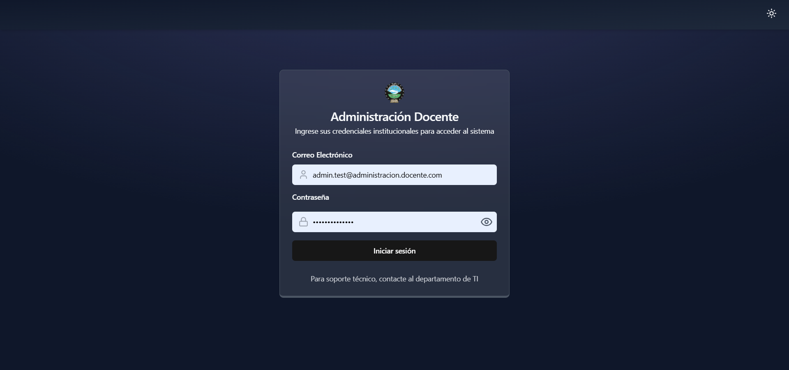
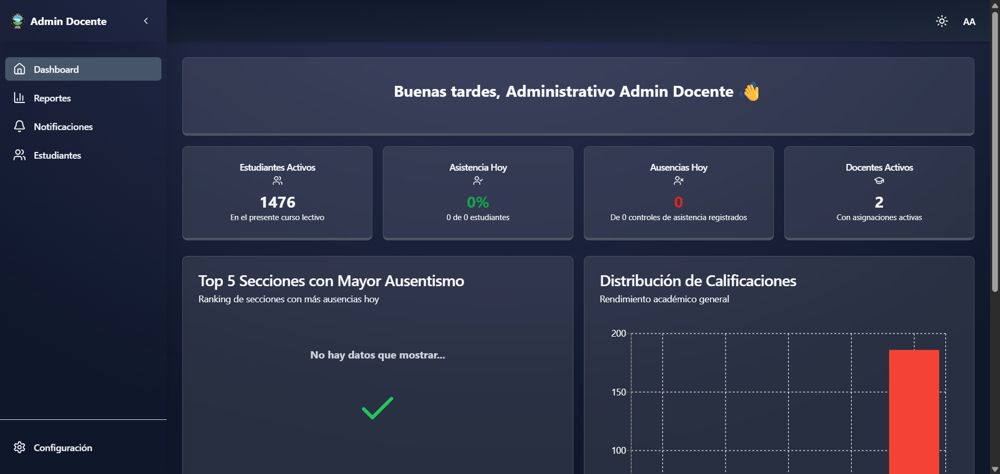
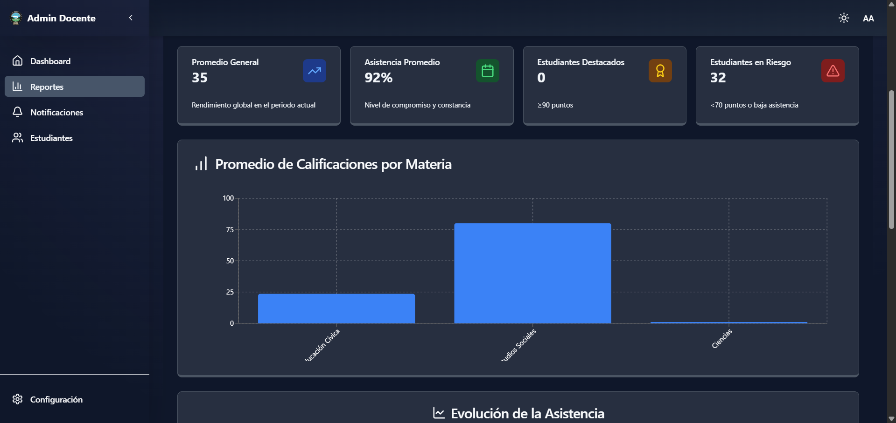
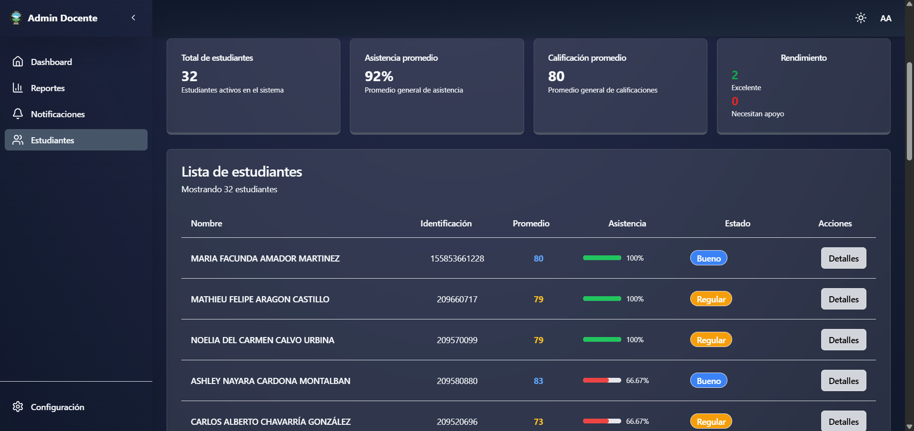
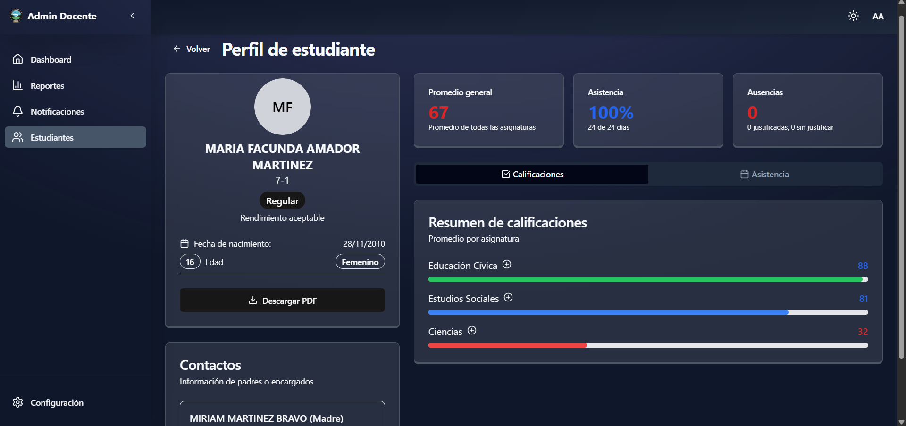
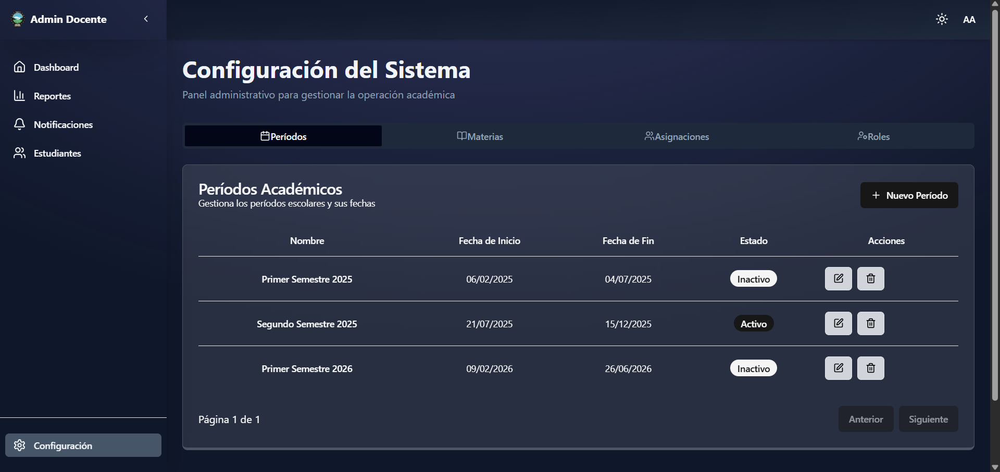
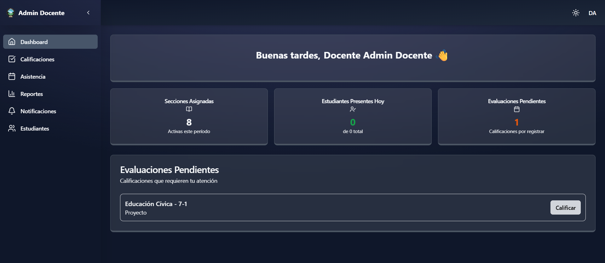
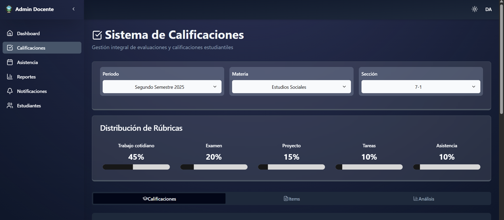
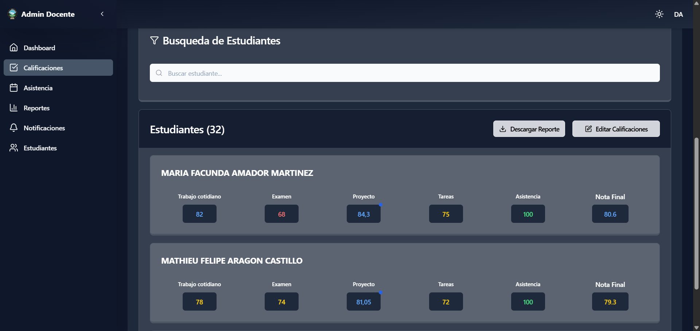
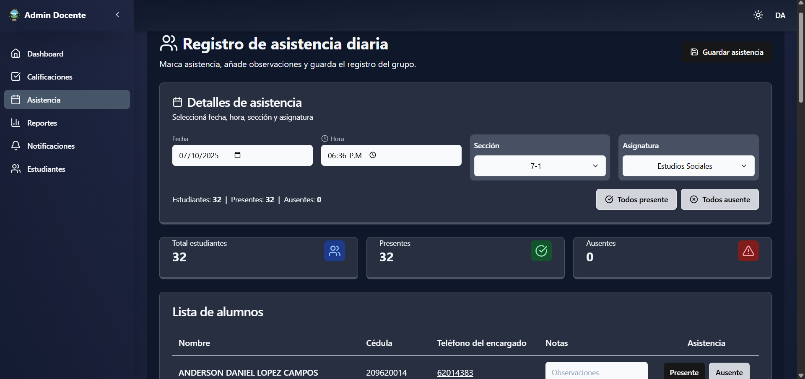

# ctp-docente-portal

> Portal for academic staff to manage sections, evaluations, attendance and reports.

## Table of contents

- [Features](#features)
- [Tech stack](#tech-stack)
- [Architecture](#architecture)
- [Prerequisites](#prerequisites)
- [Quickstart](#quickstart)
  - [Server (ASP.NET Core)](#server-aspnet-core)
  - [Client (Vite + React)](#client-vite--react)
- [Database / Migrations](#database--migrations)
- [Running tests](#running-tests)
- [Administrative View](#administrative-view)
- [Teacher View](#teacher-view)

## Features

- User authentication (JWT)
- Academic periods management
- Sections & enrollment management
- Attendance tracking
- Evaluation items, criteria and scoring
- PDF / CSV reporting endpoints
- Dashboard statistics and notifications

## Tech stack

- Backend: ASP.NET Core 8 (C#)
- Frontend: React + Vite
- Styling: Tailwind CSS
- Database: (EF Core) - SQL Server / configurable via `appsettings.json`
- Containerization: Docker (Dockerfile provided)

## Architecture

This repository uses a separated frontend (`ctp-docente-portal.client`) and backend (`ctp-docente-portal.Server`) approach. The server exposes REST endpoints consumed by the client app.

## Prerequisites

- .NET SDK 8.x
- Node.js 18+ and npm (or pnpm/yarn)
- SQL Server (or any DB supported and configured via EF Core)
- Optional: Docker

## Quickstart

Follow these steps to run both server and client locally.

### Server (ASP.NET Core)

1. From the repository root, restore and build:

```bash
dotnet restore
dotnet build
```

2. Configure connection string and any secrets in `ctp-docente-portal.Server/appsettings.Development.json` or environment variables.

3. Apply EF Core migrations (if using EF migrations):

```bash
cd ctp-docente-portal.Server
dotnet ef database update
```

4. Run the server:

```bash
dotnet run --project ctp-docente-portal.Server
```

The server will start (by default) on the configured port; check terminal output for the exact URL.

### Client (Vite + React)

1. Install dependencies and run dev server:

```bash
cd ctp-docente-portal.client
npm install
npm run dev
```

2. Open the URL printed by Vite (typically `http://localhost:5173`). Configure the client to point to the backend API via environment variables or the client config.

### Run both together (recommended workflow)

Start the backend first, then the frontend. The frontend proxies API requests to the backend in development (see the client configuration).

## Database / Migrations

- Migrations live in the server project under `Migrations/`.
- To add a migration:

```bash
cd ctp-docente-portal.Server
dotnet ef migrations add <Name>
dotnet ef database update
```

Ensure the `Microsoft.EntityFrameworkCore.Tools` package is available and the project builds before running migrations.

## Running tests

Run backend tests:

```bash
dotnet test ctp-docente-portal.Tests
```

## Administrative View













## Teacher View









## Docker

Build the image (root contains `Dockerfile`):

```bash
docker build -t ctp-docente-portal:latest .
```

Run a container (adjust ports and environment):

```bash
docker run -e "ASPNETCORE_ENVIRONMENT=Production" -p 5000:80 ctp-docente-portal:latest
```

## Useful files

- `ctp-docente-portal.Server/` — backend project
- `ctp-docente-portal.client/` — frontend project
- `ctp-docente-portal.Tests/` — server tests
